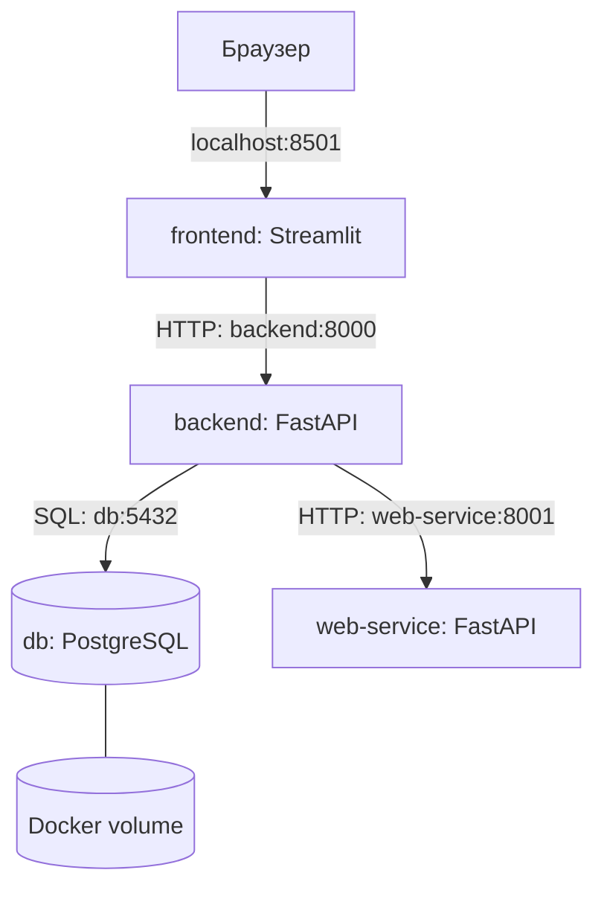

# 🎮 GameVault — каталог видеоигр на Docker Compose

**Лабораторная работа:** «Контейнеризация многокомпонентных приложений с помощью Docker Compose»  
**Индивидуальный вариант:** №37 — «Каталог видеоигр»  
**Предметная область:** поиск видеоигр по жанрам и минимальным системным требованиям; личная библиотека пользователя.

Проект переработан из учебного примера `frontend + backend + PostgreSQL` с товарами. Он состоит из **четырёх независимых контейнеров**, как требует задание. Для каталога предусмотрен отдельный **локальный web-service (микросервис-эмулятор)**: интернет и API-ключи для работы приложения не нужны.

## Что умеет приложение

1. **🔍 Найти подходящие игры** — поиск в web-service по названию, жанру и доступным ресурсам компьютера (RAM, свободное место, VRAM). Показываются только игры с требованиями не выше указанных ресурсов.
2. **📚 Показать / обновить библиотеку** — чтение игр, сохранённых в PostgreSQL.
3. **＋ В мою библиотеку** — добавление игры из найденного каталога в базу (повторное добавление запрещено).
4. **💾 Сохранить** — изменение статуса (планирую / играю / пройдено) и оценки игры от 1 до 10.
5. **🗑️ Удалить из библиотеки** — удаление записи из базы.

> **Важно:** данные каталога и минимальные системные требования — учебные, приближённые примеры, а не официальные характеристики от издателей. В демонстрационной фильтрации учитываются RAM, свободное место и VRAM; CPU/GPU показываются справочно.

## Архитектура



| Контейнер | Технологии | Назначение | Порт |
|---|---|---|---|
| `frontend` | Python, Streamlit | Интерфейс, кнопки, карточки игр | `localhost:8501` |
| `backend` | Python, FastAPI, psycopg, httpx | REST API и CRUD для библиотеки; прокси для каталога | `localhost:8000` (только с этого ПК) |
| `db` | PostgreSQL 16 | Личная библиотека + начальные записи | `5432`, только внутренняя сеть |
| `web-service` | Python, FastAPI | Каталог 24 игр; поиск по жанру и требованиям | `8001`, только внутренняя сеть |

Сервисы взаимодействуют по именам контейнеров во внутренней bridge-сети `catalog_net`. Контейнеры запускаются с `depends_on` и проверками состояния `healthcheck`. Данные БД сохраняются в именованном томе `postgres_data`.

## Структура проекта

```text
DockerDemo/
├── docker-compose.yml
├── .env.example
├── .gitignore
├── .dockerignore
├── .github/
│   └── workflows/ci.yml
├── README.md
├── backend/
│   ├── app.py
│   ├── Dockerfile
│   ├── requirements.txt
│   └── .dockerignore
├── frontend/
│   ├── app.py
│   ├── Dockerfile
│   ├── requirements.txt
│   └── .dockerignore
├── db/
│   └── init.sql
├── web-service/
│   ├── app.py
│   ├── Dockerfile
│   ├── requirements.txt
│   └── .dockerignore
└── tests/
    ├── test_web_service.py
    └── requirements.txt
```

## 🚀 Запуск в Docker Desktop на Windows

**Нужно:** установленный Docker Desktop с запущенным движком (статус **Engine running**) и PowerShell. Установка Python на хост не нужна.

1. Распакуйте ZIP в `C:\DockerDemo` (важно: внутри должна лежать папка с `docker-compose.yml`).
2. Откройте PowerShell в папке проекта и создайте локальный `.env` из примера:

   ```powershell
   cd C:\DockerDemo
   Copy-Item .env.example .env
   ```

3. Соберите и запустите контейнеры:

   ```powershell
   docker compose up -d --build
   ```

4. Убедитесь, что контейнеры запустились:

   ```powershell
   docker compose ps
   ```

   Должны присутствовать **4 сервиса**: `db`, `web-service`, `backend`, `frontend`. После проверок здоровья состояние контейнеров будет `healthy`.

5. Откройте браузер:

   - **Приложение:** http://localhost:8501
   - **Swagger (backend API):** http://localhost:8000/docs

6. На первой вкладке выберите жанр и ресурсы ПК и нажмите **«🔍 Найти подходящие игры»**. Добавьте игру кнопкой **«＋ В мою библиотеку»**.
7. На второй вкладке нажмите **«📚 Показать / обновить библиотеку»**. Измените статус и оценку, нажмите **«💾 Сохранить»** или удалите запись.

Для запуска без фонового режима можно использовать `docker compose up --build`, как в формулировке лабораторной.

### Управление и диагностика

```powershell
docker compose ps                 # состояние всех 4 контейнеров
docker compose logs --tail=100    # последние логи
docker compose logs -f backend   # подробные логи backend
docker compose down              # остановить, сохранив данные в volume
docker compose up -d             # снова запустить
```

**Полный сброс** базы с повторным применением `db/init.sql`:

```powershell
docker compose down -v           # ВНИМАНИЕ: удаляет все сохраненные игры!
docker compose up -d --build
```

Файл `db/init.sql` выполняется **только при первом создании пустого тома PostgreSQL**. Если изменить SQL при уже созданном томе, необходимо осознанно использовать `down -v` или применить миграцию самостоятельно.

### Если что-то не работает

- `POSTGRES_PASSWORD` не найден — выполните `Copy-Item .env.example .env` в корне проекта.
- Порт `8501` занят — поменяйте в `docker-compose.yml` слева порт, например `"8502:8501"`, и откройте `http://localhost:8502`.
- Порт `8000` занят — поменяйте `"127.0.0.1:8000:8000"` на `"127.0.0.1:8002:8000"` (тогда Swagger: `http://localhost:8002/docs`).
- Контейнер не стартует — проверьте `docker compose ps -a` и `docker compose logs --tail=100`.
- База не инициализировалась новыми демо-данными — прочитайте примечание про PostgreSQL volume выше.

## API

| Метод | Endpoint | Описание |
|---|---|---|
| `GET` | `/health` | Состояние backend |
| `GET` | `/genres` | Список жанров (через web-service) |
| `GET` | `/games?genre=RPG&ram_gb=8&storage_gb=80&vram_gb=4` | Подбор по жанру и доступным ресурсам ПК |
| `GET` | `/library` | Все игры в личной библиотеке PostgreSQL |
| `POST` | `/library` | Добавить игру по ID из каталога |
| `PATCH` | `/library/{id}` | Изменить статус и/или рейтинг |
| `DELETE` | `/library/{id}` | Удалить игру из библиотеки |

Пример тела `POST /library`:

```json
{"game_id": 5, "status": "planned"}
```

Пример `PATCH /library/1`:

```json
{"status": "completed", "rating": 10}
```

Значения статуса: `planned`, `playing`, `completed`. Рейтинг: от 1 до 10 или `null`, чтобы удалить оценку. Консоль Swagger позволяет вызывать API без отдельных клиентов.

### Тесты web-service без Docker

Для необязательного запуска модульных тестов на ПК с Python:

```powershell
python -m pip install -r tests/requirements.txt
python -m pytest -q tests
```

Эти тесты проверяют ответы сервиса и фильтрацию без подключения к PostgreSQL. Сквозная проверка взаимодействия всех четырёх контейнеров проводится в Docker Desktop.

## Публикация в публичный GitHub-репозиторий

Не загружайте файл `.env` (он включён в `.gitignore`). Загрузите **всё содержимое папки `DockerDemo`**, в том числе скрытые файлы `.env.example` и `.gitignore`.

Вариант через [GitHub](https://github.com/new): создайте репозиторий `DockerDemo-GameCatalog`, выберите **Public**, затем в PowerShell из корня проекта выполните:

```powershell
git init
git add .
git commit -m "Лабораторная №37: каталог видеоигр на Docker Compose"
git branch -M main
git remote add origin https://github.com/ВАШ_ЛОГИН/DockerDemo-GameCatalog.git
git push -u origin main
```

Если установлен GitHub CLI и пользователь вошёл в `gh auth login`, вместо ручного создания и `git remote add`/`git push` можно выполнить:

```powershell
git init
git add .
git commit -m "Лабораторная №37: каталог видеоигр на Docker Compose"
git branch -M main
gh repo create DockerDemo-GameCatalog --public --source=. --remote=origin --push
```

Итоговый адрес: `https://github.com/ВАШ_ЛОГИН/DockerDemo-GameCatalog`. Внесите **свой настоящий URL** в таблицу группы, указанную в лабораторном задании.

## Проверка по критериям лабораторной

- ✅ Четыре контейнера в одном `docker-compose.yml`.
- ✅ Frontend: 2 обязательные рабочие кнопки (поиск через web-service; чтение из БД) и дополнительные CRUD-кнопки.
- ✅ Backend REST API, обращения к БД и к независимому web-service.
- ✅ PostgreSQL с автоматической первоначальной загрузкой данных (`db/init.sql`), сохранение в volume.
- ✅ `depends_on`, `healthcheck`, переменные окружения, сеть bridge.
- ✅ `.gitignore`, `.env.example`, инструкции запуска и публикации.

**Проверки CI:** после публикации на GitHub workflow `.github/workflows/ci.yml` запускает тесты web-service и проверку синтаксиса `docker compose config`.

**Ограничение:** каталог содержит фиксированный учебный набор из 24 игр. Учебный web-service не обращается к реальной базе издателей игр.
